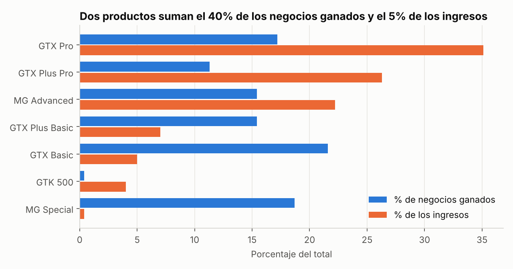
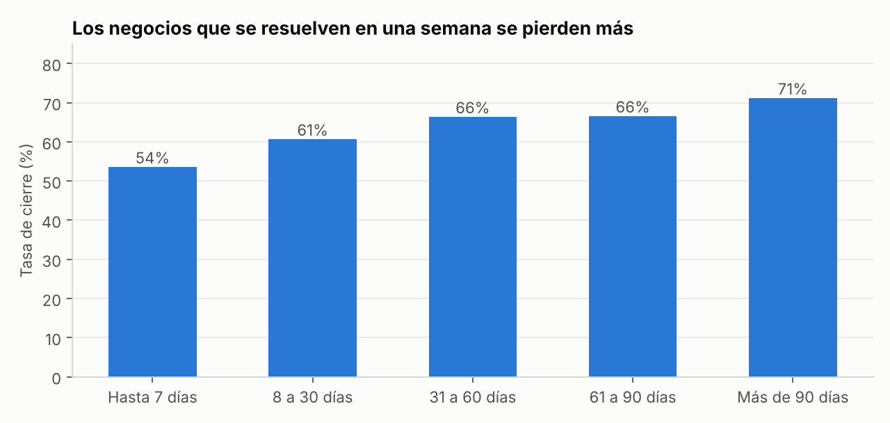
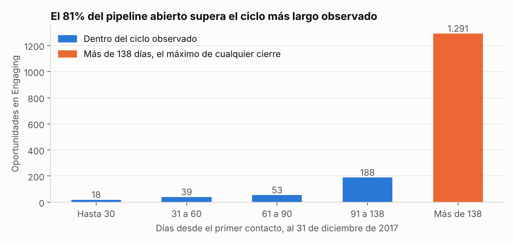

# Embudo de ventas B2B, dónde se gana y dónde se pierde

## Problema del negocio

Una empresa que vende hardware a otras empresas registra sus oportunidades en un CRM con cuatro etapas, Prospecting, Engaging, Won y Lost. El gerente de ventas necesita saber dónde poner la atención del equipo el próximo trimestre y qué tan confiable es el pipeline abierto para proyectar ingresos.

## Datos

[CRM Sales Opportunities](https://mavenanalytics.io/data-playground/crm-sales-opportunities), de Maven Analytics, con licencia de dominio público. Es una empresa ficticia con 8.800 oportunidades entre octubre de 2016 y diciembre de 2017, repartidas en cuatro tablas, oportunidades, cuentas, productos y equipos de venta. Los archivos originales están en la carpeta `data`, junto con el diccionario de datos.

## Metodología

1. **Exploración y limpieza.** El producto GTX Pro aparece escrito como GTXPro en 1.480 oportunidades, lo que lo deja por fuera de cualquier cruce con la tabla de precios. El sector technology tiene un error de digitación. Corregí los dos con vistas SQL, sin modificar los archivos originales, y revisé que los nulos de fechas y valores coincidieran con la etapa de cada oportunidad.
2. **Embudo y tasa de cierre** por producto, sector del cliente, oficina regional y gerente.
3. **Mezcla de productos**, comparando el peso de cada uno en los negocios ganados y en los ingresos.
4. **Ciclo de venta**, con la tasa de cierre por tramo de días entre el primer contacto y el cierre.
5. **Salud del pipeline abierto** al 31 de diciembre de 2017, con antigüedad de las oportunidades, cuentas sin registrar y valor esperado.

Cada pregunta se responde con una consulta SQL sobre una base SQLite en memoria, con JOIN, CTE, CASE y funciones de ventana. Python con pandas y Matplotlib quedó para revisar los resultados y graficar.

## Herramientas

SQL (SQLite), Python (pandas, Matplotlib), Jupyter.

## Resultados

**1. La tasa de cierre es estable.** El 63,2% de las oportunidades cerradas se gana. Entre productos, sectores, oficinas y gerentes la tasa solo se mueve entre 60% y 65%. Un producto de 55 dólares se cierra en la misma proporción que uno de 26.768.

**2. Los ingresos dependen de qué se vende.** MG Special y GTX Basic suman el 40,3% de los negocios ganados y el 5,4% de los ingresos. GTX Pro, GTX Plus Pro y MG Advanced suman el 43,9% de los negocios y el 83,5% de los ingresos.



**3. Las pérdidas llegan rápido.** La mitad de los negocios perdidos se resuelve en 14 días o menos, y la mitad de los ganados tarda 57 días o más. Cuando un negocio se resuelve en la primera semana se gana el 54% de las veces. Después de 90 días, el 71%.



**4. El pipeline abierto está inflado.** Ningún negocio cerrado tardó más de 138 días, y el 81% de las oportunidades en Engaging, 1.291 de 1.589, ya superó ese tiempo. Con todo el pipeline, el valor esperado ronda 2,44 millones de dólares. Con solo las oportunidades vigentes baja a 0,44 millones, un 82% menos. Además, dos de cada tres oportunidades abiertas no tienen registrada la empresa cliente, mientras todas las cerradas sí la tienen.



## Lectura de negocio

La primera hipótesis de un gerente suele ser que algún segmento se está cerrando mal. Los datos la descartan. El equipo cierra igual de bien en todas partes, y la diferencia en ingresos sale de las oportunidades a las que le dedica el tiempo. Un MG Special se gana con la misma probabilidad que un GTX Pro y deja una fracción del dinero.

El pipeline abierto cuenta otra historia. Todo indica que el equipo registra la cuenta recién al cerrar, y cientos de oportunidades siguen abiertas mucho después del momento en que cualquier negocio de esta empresa se ha resuelto. Un pronóstico construido sobre ese pipeline promete más de cinco veces lo que el historial respalda.

## Recomendaciones

1. Revisar el pipeline cada semana empezando por GTX Pro, GTX Plus Pro y MG Advanced, que son las oportunidades que mueven los ingresos.
2. Recalificar toda oportunidad en Engaging con más de 115 días, el percentil 95 del ciclo, y cerrar como perdida la que supere 138 días.
3. Volver obligatorio el campo de cuenta desde Prospecting, para poder segmentar y priorizar el pipeline abierto.
4. Definir criterios mínimos de calificación antes de pasar una oportunidad a Engaging, para reducir las pérdidas de la primera semana.
5. Proyectar ingresos con el valor esperado de las oportunidades vigentes.

## Limitaciones

- Es un dataset público de una empresa ficticia, pensado para práctica.
- La relación entre duración del ciclo y probabilidad de ganar es una correlación. Los datos no muestran que alargar una venta la haga más probable.
- El valor esperado usa el precio de lista y la tasa de cierre histórica de cada producto. Sirve como orden de magnitud.
- Los datos no explican por qué el equipo vende tantos productos pequeños. Para responderlo haría falta hablar con los vendedores y revisar cómo se asignan los leads.

## Cómo reproducir

1. Descargar la carpeta completa del proyecto.
2. Abrir `notebooks/embudo_ventas_b2b.ipynb` en Jupyter, con las carpetas `data` e `img` al mismo nivel que `notebooks`.
3. Ejecutar todas las celdas. Las consultas también están juntas en `sql/consultas.sql`.

## Estructura

```
proyecto-embudo-ventas-b2b/
├── data/                  Tablas originales y diccionario de datos
├── sql/consultas.sql      Vistas de limpieza y las ocho consultas del análisis
├── notebooks/             Notebook ejecutado con resultados y lecturas
├── img/                   Gráficos del README
└── FICHA_PROYECTO.md      Ficha del proyecto según la plantilla del coach
```
